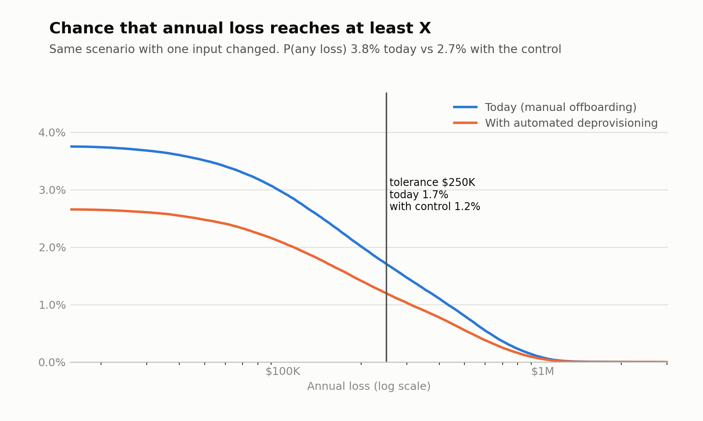
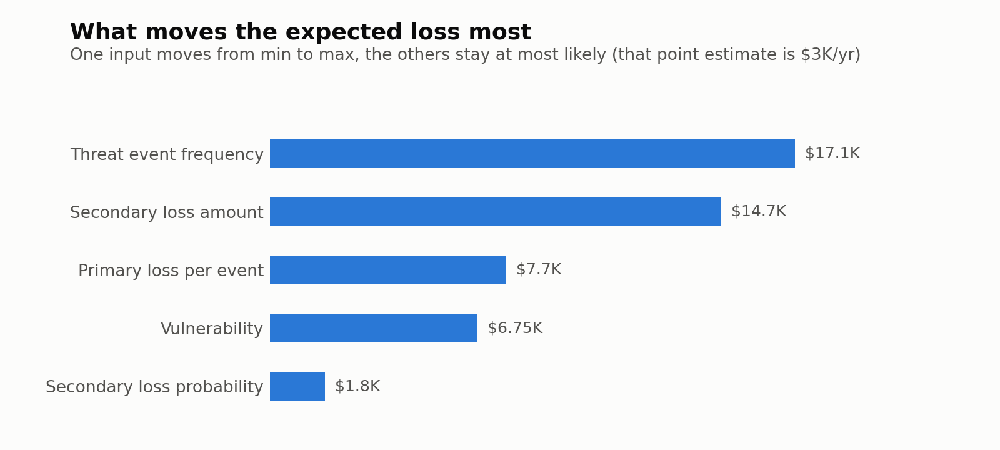
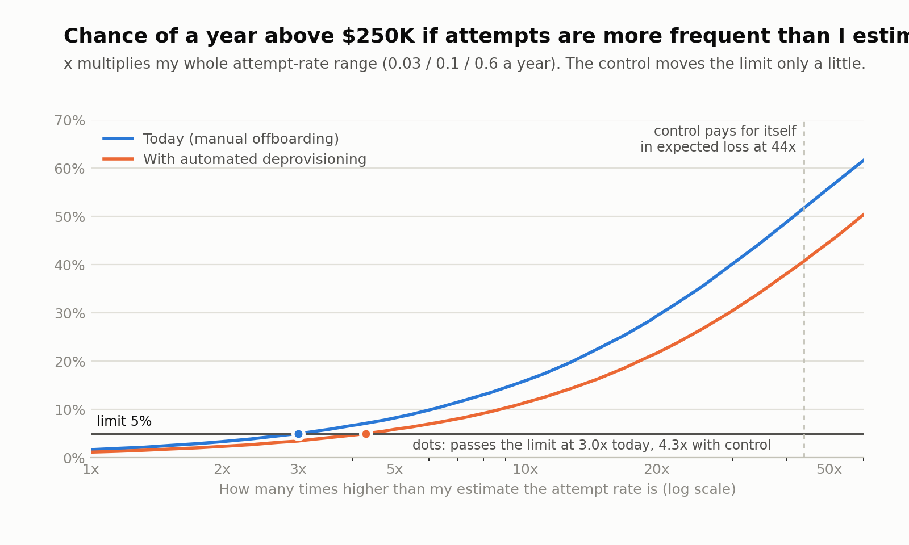

# FAIR Monte Carlo: a former employee's leftover access at a fictional analytics firm

Estimates the annual loss from a former employee or contractor using access that was not removed in time, then tests whether a $140K-a-year automated deprovisioning tool is worth buying. Expected loss is about $12K a year, with a 3.8% chance of any loss in a year and a 1.7% chance of a year above the $250K tolerance. The tool would cut expected loss by about $3.5K a year, so for this scenario alone I recommend against buying it. That holds even if attempts are many times more frequent than I estimate. The tolerance does not: the chance of a year above $250K passes my 5% limit at about 3 times my estimated attempt rate.

> **All numbers in this repository are invented for a fictional company** (M&F Analysis, see `company_profile.md`). They illustrate the method and are not drawn from any real organization or client.

## How this was built

I built this with Claude (Anthropic). Claude wrote the simulation code, the calibration quiz, the fictional company profile, and the starting estimates, worksheet text, and this write-up. I took the calibration quiz myself (my scores are in `calibration/calibration_log.csv`: 8 of 10 on set 1 and 6 of 20 on the fresh set 2, against a target of about 9 and 18, so my ranges were too narrow), and set up the repository. The estimates below are my working baseline and nobody has measured them. Anything I change goes in this table.

| Date | Input | Was | Now | Why |
|---|---|---|---|---|
| none yet | | | | |

An independent reviewer (a separate Claude instance given only the files) checked the first draft and found problems. The corrections are:

- The first draft said both scenarios used the same random draws. They did not. Each input now has its own random stream, and expected loss is also computed exactly, so the comparison no longer depends on that claim.
- The first draft said the tool would pay for itself only if attempts were 45 times higher, and called the result robust. That covers the purchase decision, not the tolerance. The new attempt-rate sweep below shows the tolerance is passed at about 3 times.
- The with-automation vulnerability is now built from an explicit employee/contractor table (`scenario.md`). Its most likely value moved from 0.13 to 0.14.
- The rule-of-three cross-check now accounts for weak detection, and the cheaper alternatives are costed roughly.

## Scenario

In the next 12 months, a former employee or contractor of M&F Analysis whose access has not yet been removed uses it (an active account or a credential they still know) to read or copy client data in the cloud data warehouse, resulting in a confidentiality incident that requires investigation and client notification.

Out of scope: outside attackers, misuse by current staff, accidental exposure, and sabotage or deletion. Full scoping is in `scenario.md`.

## Method

Risk is modeled with the FAIR taxonomy: annual loss is how often a loss event happens times how much it costs.

```
Loss event frequency  = threat event frequency x vulnerability
Loss per event        = primary loss + (secondary loss, with some probability)
Annual loss           = simulated over 1,000,000 possible years (Monte Carlo)
```

Each input is a range (minimum, most likely, maximum) sampled with a PERT distribution. The number of events in a year is Poisson. `src/fair_sim.py` has the exact model. Because the inputs are independent, expected loss also has an exact formula, and the simulated mean is checked against it. `src/compare.py` runs two scenarios, tests a control against its price, and sweeps the attempt rate.

## Inputs and rationale

| Input | min | most likely | max | Why |
|---|---|---|---|---|
| Threat event frequency (attempts per year) | 0.03 | 0.1 | 0.6 | About 190 departures a year, about 8 contentious. About 1% of contentious departures try, plus a tiny rate among friendly ones. A clean five-year record only caps *caught* attempts at about 0.6 a year; with weak detection the true rate could be higher, so the max is not a ceiling. |
| Vulnerability (attempt succeeds) | 0.05 | 0.2 | 0.5 | About 30% chance access still works (SSO delay, 13 manual apps, quarterly credential rotation, late contractor records) times about 70% chance data is read before anyone notices. |
| Primary loss (USD) | 15K | 75K | 400K | Outside incident-response hours at about $350 an hour, plus internal time and legal review. Counted on every event. |
| Secondary loss probability | 0.25 | 0.5 | 0.85 | About 60% chance the event is discovered within the year times about 85% chance costs follow (72-hour notice clauses, personal data). |
| Secondary loss (USD) | 30K | 150K | 1.5M | Notification and legal, a credit, and a chance of losing a client; high end is several clients and terminations. Before insurance. |
| **With automation:** vulnerability | 0.035 | 0.14 | 0.35 | Today's range times 0.70. The tool fixes employees' SSO and 9 of 13 manual apps. Contractors are recorded late and shared credentials are still rotated quarterly, so about 21 of today's 30 points of exposure remain (table in `scenario.md`). Everything else unchanged. |

The full reasoning for each range and the assumptions log are in `scenario.md`.

## Results

| | Today (manual) | With automation |
|---|---|---|
| Chance of any loss in a year | 3.8% | 2.7% |
| Expected annual loss, exact | $11.7K | $8.2K |
| Expected annual loss, simulated (± standard error) | $11.7K ± $78 | $8.2K ± $65 |
| Median / 90th / 95th percentile | $0 | $0 |
| 99th percentile | $431K | $310K |
| Chance of a year above $250K | 1.7% | 1.2% |



How to read this:
- **Most years nothing happens.** About 96% of simulated years have no loss, so the median and 90th percentile are $0. The risk lives in the rare bad year, shown by the 99th percentile.
- **The average is higher than the "all most-likely" case.** The point estimate using every most-likely value is about $3K a year, but the mean is $11.7K, because the ranges lean toward bad outcomes and the average includes them. The chart below varies one input at a time around the $3K point, so its bars show relative importance, not shares of the $11.7K.
- **Threat event frequency is the biggest driver and my weakest input.** The secondary loss amount is a close second.
- **The tool's effect is small.** It reduces expected loss by about $3.5K a year (exact; simulated $3.5K ± $0.1K) against an annualized cost of about $153K ($140K a year plus $40K spread over three years). The most any control could save for this scenario is today's whole expected loss, about $12K.



### What if attempts are more frequent than I estimated?

My weakest input is how often a former employee actually tries. The sweep multiplies my whole attempt-rate range (0.03 / 0.1 / 0.6 a year) and recomputes two things: the chance of a year above $250K, and the control's net benefit.

| Attempts vs. my estimate | Chance of a year above $250K, today | With automation | Net benefit of the tool per year |
|---|---|---|---|
| 1x (my estimate) | 1.7% | 1.2% | -$150K |
| 2x | 3.3% | 2.4% | -$146K |
| **3x** | **5.0%** | 3.5% | -$143K |
| 4x | 6.7% | 4.7% | -$139K |
| 5x | 8.3% | 5.9% | -$136K |
| 10x | 16.0% | 11.5% | -$118K |
| 20x | 29.3% | 21.6% | -$83K |
| 44x (break-even) | 51.7% | 40.7% | $0 |



Two separate conclusions:
- **Buying the tool is a clear no on expected loss.** Attempts would have to be about 44 times my estimate before it pays for itself, and by then the chance of a bad year is above 40% even with the tool.
- **The tolerance is not robust.** My 5% limit is passed at about 3.0 times my estimate today (a most likely rate of 0.3 attempts a year, one every three years, which is inside my own range) and at about 4.3 times with the tool. The tool does little for this.

Run `python3 src/compare.py inputs.json inputs_after.json --out output --annual-cost 140000 --one-time 40000 --years 3` to reproduce all of this; the full numbers are in `output/comparison.json`.

## Recommendation (the CISO paragraph)

Do not buy the automated deprovisioning tool on the strength of this scenario, and measure how often former staff try to use leftover access before spending anything else. At my estimates, expected loss from a former employee or contractor using access that was not removed in time is about $12K a year, with a 1.7% chance of a year above our $250K tolerance. The tool would cut that by only about $3.5K a year against about $153K a year in cost, and no control can save more than the $12K total, so the purchase conclusion survives even if I am badly wrong: attempts would have to be about 44 times my estimate for the tool to pay for itself. The tolerance conclusion is much less safe. If attempts are about three times my estimate, which is inside my own range, the chance of exceeding $250K passes our 5% limit, and the tool only moves that point to about four times. It also leaves most of the exposure in place, because contractors are recorded late and shared credentials are rotated only each quarter. Rotating shared credentials when a holder leaves and having HR own contractor end dates would remove more exposure for far less money, but on my rough costs they only about break even on this scenario alone, so I would justify them by the other risks they reduce. My least certain input is the attempt rate: no attempt has been caught, but detection is weak, so the clean record says little. A review of twelve months of logins after each departure date would replace my guess with data. I would revisit this if an attempt is confirmed, if that review finds logins after departure, if contractor volume or attrition rises sharply, if leadership lowers the tolerance, or if the vendor's price falls toward the size of the benefit.

## What I would change with better data

- **Threat event frequency:** count real logins and failed logins by departed accounts, and the number of contentious departures, to replace my guess with an observed rate. This would move the result most.
- **Vulnerability:** measure the real delay between the HR record and each system being switched off, and how many leavers knew a shared credential.
- **Discovery probability:** test how often the query-log review would catch a former employee's session.
- **Loss amounts:** use incident-response invoices, breach-cost benchmarks, and contract data on how often clients actually terminate.

## Limitations

- Each uncertain input is drawn once per simulated year and shared by every event that year, so all events in a year cost the same.
- The loss distribution mixes two kinds of uncertainty: what the true rates and costs are (my ranges) and which events happen this year. Read it as the chance of a year like this, given what I know today.
- Inputs are sampled independently. In reality a bigger incident tends to cost more on every dimension, which would fatten the tail.
- PERT minimum and maximum are hard limits. The calibration quiz trains 90% ranges, which can be missed 10% of the time, so the model's tails are thinner than my stated beliefs.
- Inputs are expert estimates, not measured data; results are only as good as the ranges.
- Weak log monitoring appears in both vulnerability (data read before anyone notices) and discovery (found within the year). They are different questions but not independent.
- Discovery is applied to secondary loss only; primary loss is counted on every event. That overstates the primary part of expected loss by up to about $1.8K a year if undiscovered events are never investigated.
- The control's effect on vulnerability rests on a judgment-based table (employees versus contractors, three routes, routes added together), and the model assumes the tool does not deter attempts.
- Losses are before insurance; insurance ($5M limit, $100K retention) would absorb part of a large loss.
- The tool's cost is the vendor quote only. Internal administration time and discounting are ignored; both would make the tool look worse.
- One scenario only. The tool might be justified by other scenarios or by compliance, which this analysis does not count.
- The tolerance ($250K, at most 5% chance of exceeding it) is my chosen cutoff, not leadership's.

## Run it

```bash
python3 -m venv .venv && source .venv/bin/activate
pip install -r requirements.txt
python3 calibration/quiz.py --set 2                          # calibrate first
python3 src/fair_sim.py inputs.json --out output/baseline
python3 src/fair_sim.py inputs_after.json --out output/with_automation
python3 src/compare.py inputs.json inputs_after.json --out output \
    --annual-cost 140000 --one-time 40000 --years 3
```

The seed is fixed, so you get the same numbers every time. The comparison takes about 15 seconds because of the sweep.
