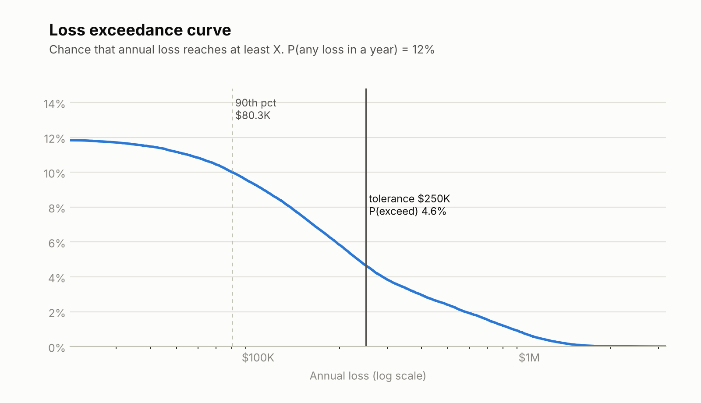
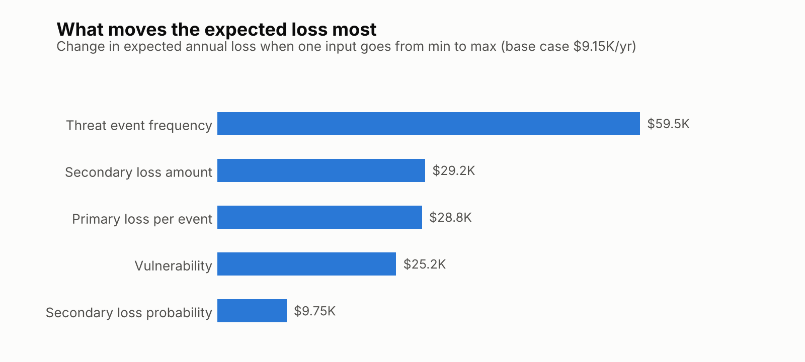

# FAIR Monte Carlo: <scenario name>

<!-- TODO(you): 2-3 sentences. What question does this answer, for whom, and what is the headline result?
     Example shape: "Estimates the annual loss exposure from <scenario>. Median $X, 90th percentile $Y;
     the biggest driver is Z." Write it last, after you have results. -->

> All numbers in this repository are invented for a fictional company. They illustrate the method and
> are not drawn from any real organization.

## Scenario

<!-- TODO(you): asset, threat, effect, time frame, what is out of scope. Copy from scenario.md. -->

## Method

Risk is modeled with the FAIR taxonomy: annual loss = how often a loss event happens x how much it costs.

```
Loss event frequency  = threat event frequency x vulnerability
Loss per event        = primary loss + (secondary loss, with some probability)
Annual loss           = simulated over many possible years (Monte Carlo)
```

Each input is a calibrated range (minimum, most likely, maximum) sampled with a PERT distribution.
Event counts per year are Poisson. See `src/fair_sim.py` for the exact model and its v1 simplification
(epistemic draws are made once per simulated year).

## Inputs and rationale

<!-- TODO(you): table of the five inputs, your ranges, and one line on why each. Copy from scenario.md. -->

## Results





<!-- TODO(you): read the numbers from output/results.json. State median, 90th percentile, probability of
     any loss, and probability of exceeding the risk tolerance. -->

## Recommendation (the CISO paragraph)

<!-- TODO(you): one paragraph. Position first. Then the tradeoff, then an honest statement of uncertainty,
     then the re-evaluation triggers (what new fact would change your answer). -->

## What I would change with better data

<!-- TODO(you): which inputs are weakest, what data would tighten them, and how the result would move. -->

## Limitations

- Epistemic draws are shared across events within a simulated year.
- Inputs are expert estimates, not measured data; results are only as good as the ranges.
- Single scenario, no control comparison yet.

## Run it

```bash
python -m venv .venv && source .venv/bin/activate
pip install -r requirements.txt
python calibration/quiz.py                       # calibrate first
python src/fair_sim.py inputs.json --out output  # simulate
```
